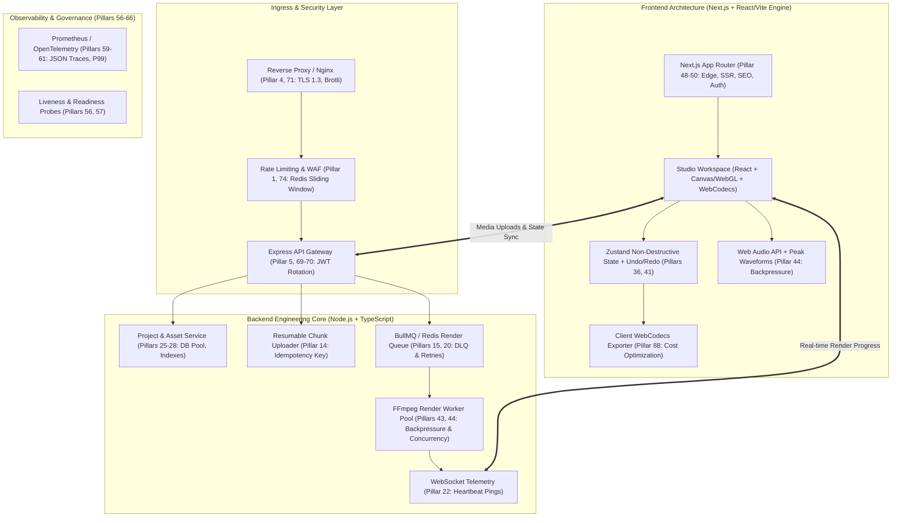

# VN Video Editor (Web Edition) — Master Architecture & Implementation Plan

> **Design & Engineering Blueprint**  
> *Inspired by VN Video Editor (VlogNow)*  
> Built strictly adhering to the **112 Pillars of Production Web Architecture** (Traffic, Resiliency, Async/Queue, Storage, Concurrency, Observability, and Security).

---

## 1. Executive Summary & Vision

**VN Video Editor (Web)** brings a desktop-grade, non-destructive video editing suite directly to the browser. It combines the sleek aesthetic and intuitive timeline ergonomics of **VN Editor** with modern web standards (WebGL, WebCodecs, Web Audio API, and high-performance FFmpeg backend rendering).

### Core Pillars
1. **Faithful VN Editor UX**: Signature dark obsidian interface (`#0A0B0E`), neon cyan accents (`#00F2FE`), multi-track hierarchical timeline (Subtitles, PIP/Overlay, Main Video, Audio/SFX), curve speed ramping, and keyframe diamond markers (`◆`).
2. **Hybrid Frontend Architecture (Next.js + React/Vite Engine)**:
   - **Next.js (App Router)**: Serves as the robust application shell, handling SEO/landing, authentication, project dashboards, API aggregation, and edge SSR.
   - **React + Vite-Powered Workstation Studio**: Isolated, client-side workstation runtime (`/editor/[id]`) optimized for zero-overhead, 60fps real-time WebGL/Canvas rendering, frame-accurate playhead scrubbing, and WebCodecs without SSR hydration conflicts.
3. **Backend Stack (Node.js + Express + TypeScript + FFmpeg)**:
   - Built to production standards: rate limiting, circuit breakers, idempotency, BullMQ/Redis async rendering queues, WebSockets for real-time render telemetry, and structured tracing.
4. **Hybrid Export Pipeline**:
   - **Tier 1 (Instant Local Export)**: WebCodecs + MP4Muxer / FFmpeg.wasm for client-side zero-server-cost export up to 1080p 60fps.
   - **Tier 2 (Server Production Export)**: Backend distributed FFmpeg worker queue for 4K, HDR, heavy LUTs, and complex motion graphics.

---

## 2. VN Editor UI / UX Design Specifications

### 2.1 Workspace Layout Grid
```
+---------------------------------------------------------------------------------------------------------------+
| [VN Logo] Project: "Cyberpunk Tokyo 4K"  |  1080p 60fps  |  [Undo ↶] [Redo ↷]  |  [Guide Margins]  | [EXPORT] |
+----------------------------------------------------------+----------------------------------------------------+
| 📁 MEDIA & ASSET BROWSER / INSPECTOR                     | 📺 PREVIEW MONITOR                                 |
| Tabs: [Media] [Audio/SFX] [Text] [Stickers] [FX] [LUTs]  | Aspect Ratio: [ 9:16 Reels v ]  Time: [00:01:24:18]|
| +------------------------------------------------------+ | +------------------------------------------------+ |
| | [ + Import Media ] [ Filter: All v ]                 | | |                                                | |
| | [Clip A.mp4]   [B-Roll.mov]   [Beats.mp3] [LUT.cube] | | |                 CANVAS MONITOR                 | |
| | [Title.preset] [Sticker.png]  [SFX.wav]   [Logo.svg] | | |               (WebGL Real-Time)                | |
| |                                                      | | |           [ Interactive Transform Box ]        | |
| | ──────────────────────────────────────────────────── | | |                                                | |
| | > CONTEXTUAL INSPECTOR (When Clip Selected)          | | +------------------------------------------------+ |
| |   • Transform: Pos(X,Y), Scale(100%), Rotation(0°)   | | [ |< ] [ < (1F) ] [ ▶ Play (Space) ] [ (1F) > ]  |
| |   • Keyframe: [ + Add Keyframe ] (Pos / Zoom / Alpha)| | Split-Screen Before/After: [ON/OFF]  Safe Area: [x]|
| |   • Speed Curve: [Montage v] [Custom Bezier Editor]  | +----------------------------------------------------+
| |   • Color Grade: Exp / Cont / Sat / Temp / Tint / LUT|                                                      |
| +------------------------------------------------------+                                                      |
+---------------------------------------------------------------------------------------------------------------+
| ⏱️ VN MULTI-TRACK TIMELINE WORKSPACE                                                                           |
| Toolbar: [✂ Split (Ctrl+B)] [🗑 Delete] [⚡ Speed] [◆ Keyframe] [🔊 Volume] [🔲 Crop] [🎨 Filter] [🔁 Reverse]   |
| Time Ruler: |--00:00--|--00:02--|--00:04--|--00:06--|--00:08--|--00:10--|--00:12--|--00:14--|--00:16--|--00:18--|
|                                                                                                               |
| [T] Subtitles / Text Track :  [ "NEON DREAMS" ]                [ "Directed by Alex" ]                         |
| [P] PIP / Overlay Track    :             [ Sticker.png ]                [ PiP B-Roll Drone ]                  |
| [V] Main Video Track       :  [ Clip 1 (3.2s) ]---[ Clip 2 (Speed Ramp) ]-----[ Clip 3 (Reverse) ]            |
| [A] Music / Audio Track    :  [ 🎵 Synthwave BGM  •  •  •  Beat Markers  •  •  •  •  •  •  •  • ]             |
| [S] Sound Effects Track    :                [ 💥 Whoosh FX ]               [ 🔔 Cinematic Bell ]              |
|                                                                                                               |
| Footer: [ - Zoom + ] [ 🧲 Magnet: ON ] [ ⚡ Auto-Ripple: ON ] [ 📍 Snap to Beats: ON ]  Duration: 00:00:18:24  |
+---------------------------------------------------------------------------------------------------------------+
```

### 2.2 Aesthetic Tokens & Color Hierarchy
- **Canvas Base**: `#08090C` (Absolute Obsidian)
- **Panel Surfaces**: `#111318` (Dark Charcoal, 1px glass border `#1F232D`)
- **Active State / Accents (VN Signature)**:
  - **Electric Cyan (`#00F2FE` / `#4FACFE`)**: Primary active track, playhead needle, selection rings, primary action buttons.
  - **Neon Amber (`#FFB300`)**: Keyframe diamond markers (`◆`), caution highlights.
  - **Neon Pink / Coral (`#FF416C`)**: Cut indicators, delete hover, audio recording state.
  - **Electric Purple (`#8A2387` / `#7F00FF`)**: Text layers and Subtitle tracks.
  - **Mint Emerald (`#00F5A0`)**: PIP/Overlay tracks and audio beat markers.
- **Typography**: Google Fonts **Inter** + **Outfit** (Tabular numbers for frame-accurate timecodes `00:00:00:00`).

---

## 3. The 112-Pillar Production Architecture Integration

Our design incorporates the **112 Production Engineering Parameters** outlined in the workspace reference:



### Key 112-Pillar Alignments:
1. **Traffic & Ingress (Pillars 1-5, 48-50)**:
   - Redis sliding-window rate limiting on media upload and render endpoints.
   - Tiered caching: L1 (memory cache for project JSON), L2 (Redis for waveforms/metadata), L3 (CDN edge for static assets and sample media).
2. **Resiliency & Latency (Pillars 10-14, 20, 44, 91-94)**:
   - **Idempotency (14)**: Media chunk uploads use client-generated `idempotency_key` (SHA-256) to resume interrupted uploads seamlessly.
   - **Circuit Breakers (10) & Timeouts (11)**: Strict timeouts on FFmpeg render jobs with automated dead-letter queues (DLQ) after 3 retries.
   - **Backpressure (44)**: Stream-based video frame extraction to prevent Node.js heap overflow.
3. **Asynchronous & Real-Time (Pillars 15-17, 21-24)**:
   - **BullMQ + Redis**: Distributed job queue for heavy FFmpeg rendering.
   - **WebSockets (22)**: Bi-directional render telemetry with heartbeat pings reporting frame-by-frame progress `[Render: 42% - Frame 1520/3600 - ETA 12s]`.
4. **Database & Storage Optimization (Pillars 25-32)**:
   - Composite indexes on `(user_id, project_id, updated_at)`.
   - Local disk / S3 chunked multipart upload.
5. **Runtime, Memory & Compute (Pillars 41-43, 89-90)**:
   - WebGL texture disposal & Canvas memory leak prevention (explicit texture de-allocation during timeline scrub).
   - Web Worker thread offloading for audio waveform calculation and beat detection.
6. **Security & Access Control (Pillars 67-80, 112)**:
   - IDOR prevention: All project modifications and asset queries enforce strict `user_id` ownership checks.
   - Parameterized FFmpeg filtergraph construction to completely eliminate command-injection risks.
   - Content Security Policy (CSP) and CORS whitelisting.

---

## 4. Module-by-Module Technical Breakdown

### Module 1: Asset Ingestion & Media Pipeline
- **Frontend**: Drag-and-drop file ingestion, local Object URLs for instant preview, client-side metadata extraction (`duration`, `dimensions`, `codec`, `audioChannels`).
- **Backend**: Resumable chunked file upload, automatic audio waveform peak extraction (`.json`), video thumbnail strip generation for hover scrubbing.

### Module 2: The VN Multi-Track Timeline Engine
- **Tracks**:
  - `TextTrack`: Subtitles, title animations, typography styling, custom fonts.
  - `PIPTrack`: Picture-in-picture clips, stickers, alpha overlay, chroma keying.
  - `MainVideoTrack`: Primary magnetic video track with gap detection, slip/slide edit, ripple deletion.
  - `AudioTrack`: Background music, sound effects, voiceovers, with beat markers.
- **Controls**:
  - Frame-accurate playhead with dynamic timecode display (`HH:MM:SS:FF`).
  - Razor / Split tool (`Ctrl + B`), Ripple Delete, Snap-to-Grid, Magnetic Attraction.
  - Multi-level Timeline Zoom (`100ms/division` up to `30s/division`).

### Module 3: Real-Time Preview Monitor & Canvas Compositor
- **Engine**: WebGL 2.0 / Canvas 2D render loop locked to requestAnimationFrame (60 FPS).
- **Features**:
  - Interactive on-screen Transform Gizmo (direct click-and-drag to reposition, scale, or rotate video clips and text).
  - Multi-aspect ratio presets: `16:9` (YouTube), `9:16` (TikTok/Shorts), `1:1` (Instagram), `4:5` (Social), `21:9` (Cinematic).
  - Safe margin overlays and center-snapping guide lines.

### Module 4: Keyframing & Animation System (Signature VN Feature)
- Add keyframes at any playhead timestamp:
  - Transform: Position `X, Y`, Scale `W, H`, Rotation `deg`, Opacity `0.0 - 1.0`.
- Interpolation: Linear, Ease-In, Ease-Out, and Cubic-Bezier.
- Visual diamond markers `◆` on timeline clips with click-to-jump navigation.

### Module 5: Speed Ramping & Bezier Curve Editor (Signature VN Feature)
- **Preset Curves**: Montage, Hero, Bullet Time, Flash In, Flash Out.
- **Custom Curve Editor**: Interactive 5-point Bezier curve editor allowing dynamic variable speed (e.g. 0.2x slow-mo into 5x speed surge).
- Automatic pitch correction via Web Audio API phase vocoder / resampling.

### Module 6: Color Grading, Filters & Transitions
- **Color Parameters**: Exposure, Brightness, Contrast, Saturation, Temperature, Tint, Highlights, Shadows, Vignette.
- **3D LUT Support**: Parsing `.cube` files directly into 3D WebGL textures for cinematic Hollywood color grading.
- **Transitions**: Cross Dissolve, Dip to Black/White, Slide, Zoom, Whip Pan, Glitch.

### Module 7: Web Audio Studio & Beat Detection
- Web Audio API pipeline with GainNodes, BiquadFilters, and AnalyserNode.
- Audio ducking (automatically lowers BGM volume when voiceover track contains audio).
- Real-time beat detection creating yellow beat dots on the music track (matching VN's signature "Edit to the Beat").

### Module 8: Hybrid Export Engine
- **Client Export (WebCodecs)**: Fast, local GPU-accelerated export directly to MP4 using `VideoEncoder` + `mp4-muxer`.
- **Backend Export (FFmpeg)**: Full-fidelity server rendering:
  - Translates the project JSON into an FFmpeg complex filtergraph (`-filter_complex`).
  - Supports NVENC/VAAPI hardware acceleration where available.
  - Live progress feedback sent to client via WebSocket (`% complete`, `remaining time`, `download URL`).

---

## 5. Non-Destructive Project Data Model (Schema)

```typescript
export interface VNProject {
  id: string;
  userId: string;
  title: string;
  version: number;
  canvas: {
    width: number;
    height: number;
    fps: number;
    aspectRatio: '16:9' | '9:16' | '1:1' | '4:5' | '21:9';
    durationMs: number;
  };
  tracks: Array<VNTrack>;
  settings: {
    snapToGrid: boolean;
    rippleEdit: boolean;
    magnetic: boolean;
  };
}

export type TrackType = 'text' | 'pip' | 'video' | 'audio' | 'sfx';

export interface VNTrack {
  id: string;
  type: TrackType;
  name: string;
  muted: boolean;
  locked: boolean;
  clips: Array<VNClip>;
}

export interface VNClip {
  id: string;
  assetId?: string;
  startMs: number;        // Position on the timeline
  durationMs: number;     // Rendered duration on the timeline
  trimInMs: number;       // Source file in-point
  trimOutMs: number;      // Source file out-point
  speed: number;          // Default: 1.0
  speedCurve?: Array<[number, number]>; // Normalized [time, speed] Bezier points
  volume: number;         // 0.0 - 2.0
  fadeInMs: number;
  fadeOutMs: number;
  transform: {
    x: number;
    y: number;
    scale: number;
    rotation: number;
    opacity: number;
  };
  keyframes: Array<VNKeyframe>;
  colorAdjustments?: {
    brightness: number;
    contrast: number;
    saturation: number;
    temperature: number;
    vignette: number;
    lutUrl?: string;
  };
  textData?: {
    text: string;
    fontSize: number;
    fontFamily: string;
    color: string;
    align: 'left' | 'center' | 'right';
  };
  transition?: {
    type: 'dissolve' | 'fadeBlack' | 'slideLeft' | 'zoomIn';
    durationMs: number;
  };
}

export interface VNKeyframe {
  id: string;
  timeMs: number;
  property: 'position' | 'scale' | 'rotation' | 'opacity';
  value: any;
  easing: 'linear' | 'easeIn' | 'easeOut' | 'easeInOut' | 'bezier';
}
```

---

## 6. Directory Structure (`backend` & `frontend`)

```
f:/krish/VN-Editor/
├── backend/
│   ├── src/
│   │   ├── config/              # Environment, Redis, DB configurations
│   │   ├── controllers/         # UploadController, RenderController, ProjectController
│   │   ├── middleware/          # RateLimiter (Redis), Auth, Idempotency, ErrorHandler
│   │   ├── routes/              # Express API Routes (/api/v1/projects, /api/v1/renders, /api/v1/media)
│   │   ├── services/
│   │   │   ├── ffmpegService.ts # Dynamic filtergraph generator & execution
│   │   │   ├── waveformService.ts# Audio peak extraction
│   │   │   ├── storageService.ts# Local / Cloud chunked storage
│   │   │   └── projectService.ts# Project state persistence & versions
│   │   ├── queues/              # BullMQ render queue & dead-letter queue (DLQ)
│   │   ├── workers/             # Background FFmpeg render worker pool
│   │   ├── websockets/          # Real-time WebSocket server for render progress
│   │   └── server.ts            # Entrypoint with health checks & graceful shutdown
│   ├── uploads/                 # Temporary media chunks & project assets
│   ├── exports/                 # Generated MP4 outputs
│   ├── package.json
│   └── tsconfig.json
│
├── frontend/
│   ├── public/                  # Presets, LUTs, default audio SFX
│   ├── src/
│   │   ├── app/                 # Next.js App Router (Landing, Dashboard, /editor/[id])
│   │   │   ├── (auth)/          # Login / Register
│   │   │   ├── (dashboard)/     # Recent Projects, Templates, Media Cloud
│   │   │   ├── editor/[id]/     # Workstation Studio (Client-only React/Vite Engine)
│   │   │   ├── layout.tsx
│   │   │   └── page.tsx
│   │   ├── components/
│   │   │   ├── Header/          # Project title, 1080p indicator, Undo/Redo, Export button
│   │   │   ├── MediaLibrary/    # Assets, Audio/Music tabs, Text presets, Filters
│   │   │   ├── PreviewPlayer/   # WebGL monitor, transform gizmo, transport controls
│   │   │   ├── Timeline/        # Multi-track workspace, ruler, playhead, track headers
│   │   │   ├── Inspector/       # Contextual controls (Keyframe editor, Speed curves, LUTs)
│   │   │   └── Modals/          # Export dialog (WebCodecs vs Server), Keyboard cheat-sheet
│   │   ├── core/
│   │   │   ├── engine/          # WebGL compositor, render loop, time synchronizer
│   │   │   ├── audio/           # Web Audio API engine, waveform generator, beat detector
│   │   │   ├── export/          # Client-side WebCodecs / MP4Muxer exporter
│   │   │   └── shortcuts/       # Global keyboard shortcuts (J, K, L, Space, Ctrl+B)
│   │   ├── store/               # Zustand project state, action history (Undo/Redo stack)
│   │   ├── styles/              # VN Obsidian Design Tokens, neon accents, glass panels
│   │   ├── types/               # TypeScript models (VNProject, VNClip, VNTrack, etc.)
│   │   └── workers/             # Dedicated Web Workers for audio processing & waveforms
│   ├── package.json
│   ├── next.config.mjs
│   ├── tsconfig.json
│   └── tailwind.config.ts / css
```

---

## 7. Phased Implementation Roadmap

| Phase | Milestone & Objectives | Detailed Deliverables |
|---|---|---|
| **Phase 1** | **Foundations, Workspace Scaffolding & 112-Pillar Ingress** | • Initialize `backend/` (TypeScript, Express, Redis, Rate Limiting, Health Checks).<br>• Initialize `frontend/` (Next.js + React/Vite workstation architecture, VN obsidian dark theme).<br>• Implement Project State Management (Zustand + Non-destructive Undo/Redo history). |
| **Phase 2** | **Asset Management, Ingestion & Media Pipeline** | • Drag-and-drop media uploader with chunking & local zero-latency Object URLs.<br>• Background audio waveform `.json` extraction and video thumbnail generator.<br>• Project asset library with search, filtering, and preview hover. |
| **Phase 3** | **Preview Monitor & Canvas Compositor Engine** | • Real-time WebGL/Canvas player running at 60 FPS.<br>• Dynamic aspect ratio presets (`16:9`, `9:16`, `1:1`, `4:5`, `21:9`).<br>• Interactive transform gizmo (drag to reposition, scale, rotate directly on the preview monitor).<br>• Transport controls (`Space` to play/pause, `J-K-L` scrubbing, frame stepping). |
| **Phase 4** | **VN Multi-Track Timeline Engine** | • High-precision zoomable timecode ruler (`00:00:00:00`).<br>• Hierarchical track lanes: Subtitle (T), PIP/Overlay (P), Main Video (V), Audio/SFX (A).<br>• Magnetic playhead, clip dragging, trimming handles, razor split (`Ctrl + B`), ripple delete. |
| **Phase 5** | **VN Signature Features (Keyframing, Speed Ramping, Audio & Color)** | • Interactive Diamond Keyframing (`◆`) on position, scale, opacity.<br>• VN 5-Point Bezier Speed Ramping Curve Editor (Montage, Hero, Custom curves).<br>• Web Audio API multi-track mixer with automatic beat detection dots on music tracks.<br>• Color grading controls (Exposure, Contrast, Saturation, Vignette) + `.cube` 3D LUT loader. |
| **Phase 6** | **Hybrid Export Pipeline & Production Hardening** | • Client-side instant WebCodecs + MP4Muxer export.<br>• Backend BullMQ + FFmpeg render queue with live WebSocket progress bar.<br>• Observability (structured JSON logs, latency tracking, health probes, P99 optimization). |
